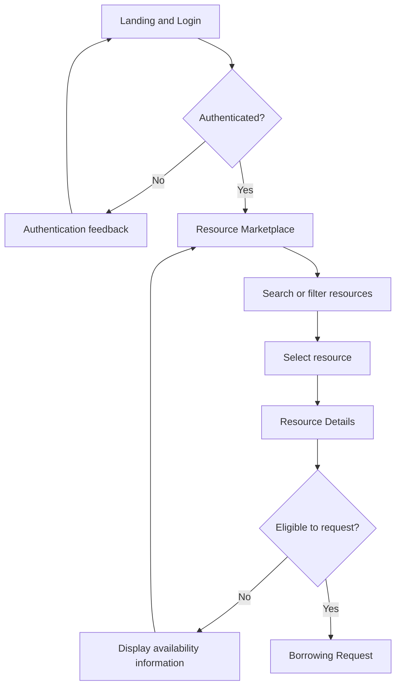
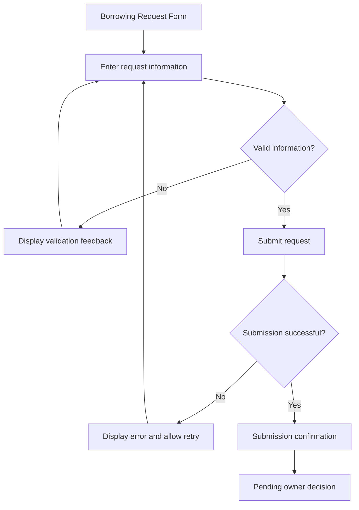
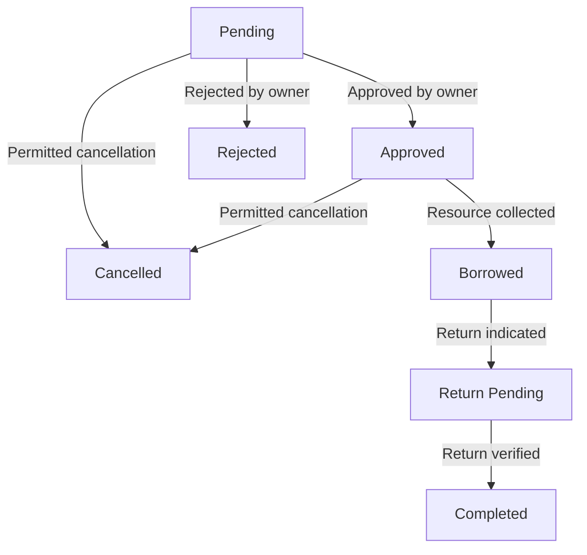

# EventPool User Flows and Navigation

## Overview

This document describes the principal user journeys within EventPool, from resource discovery to borrowing requests and club management.

It provides a functional reference for understanding how users interact with the application and how individual interfaces connect within the resource-sharing process.

## User Roles

### Borrowing Club Representative

A representative of a participating club can discover available resources, review their details, submit borrowing requests and monitor outgoing borrowing activities.

### Resource Owner

A representative of the club that owns a resource can manage its listings, review incoming borrowing requests and perform authorised approval and return-verification actions.

A club may act as both a borrower and an owner in different transactions.

### Platform Administrator

An administrator performs authorised platform-management functions according to the application's access-control rules.

## Resource Discovery

The resource-discovery journey begins when a user accesses the platform.

After authentication, the user can browse the Resource Marketplace, search for relevant items and apply filters to narrow the available listings.

Selecting a resource opens its details, allowing the user to evaluate its suitability before making a borrowing request.

## Borrowing Request Submission

The borrowing process collects the details necessary for the resource owner to assess the request.

The user identifies the requested quantity, event information, pickup date and expected return date.

The application validates the information before processing submission.

Submission does not automatically approve a borrowing request or reserve inventory.

## Request Review and Approval

Incoming Requests allows an authorised resource owner to review requests received from other clubs.

The owner may approve or reject a pending request according to the applicable permissions and inventory rules.

An approved request should reflect the corresponding inventory reservation.

A rejected request should not reserve inventory.

## Borrowing and Return

After approval, the resource may be collected according to the agreed borrowing arrangements.

The borrowing transaction progresses through the applicable collection and return stages.

When the borrower indicates that a resource has been returned, the owner may verify the return and its condition.

Inventory restoration should follow successful verification and the authoritative backend rules.

## Request Lifecycle

This diagram describes the principal request states. Permitted transitions and inventory updates must follow the implemented backend rules.

An overdue indicator may accompany an active request when the expected return date has passed.

## Club Management

Club Management provides access to the club's resource-sharing activities.

### Incoming Requests

Displays borrowing requests received for resources owned by the current club.

The interface supports authorised review and management of those requests.

### Outgoing Requests

Displays borrowing requests submitted by the current club to other resource owners.

The interface communicates request progress and relevant borrowing details.

### Events

Provides access to event-related information associated with the club's activities.

### Club Profile

Provides access to club information and relevant management functions.

Navigation between these sections should be clear, visually consistent and predictable.

## Interaction Principles

The user journey should maintain the following behaviour:

1. Resource selection should open the corresponding item details.
2. The selected resource should remain associated with the borrowing form.
3. Form validation should explain errors without unnecessarily discarding entered information.
4. Request submission should communicate the actual application result.
5. Incoming and outgoing requests should remain clearly distinguishable.
6. Shared navigation should maintain consistent placement and behaviour.
7. Users should be able to identify their current location within the application.
8. Request status and resource availability should reflect authoritative data.

## Validation

The user journeys should be evaluated through both interface review and functional testing.

Important checks include:

- Correct navigation destinations
- Accurate resource information
- Appropriate search and filter behaviour
- Form validation and feedback
- Correct request-state presentation
- Authorised owner decisions
- Appropriate inventory updates
- Responsive interface usability

The Figma prototype illustrates intended interaction patterns. Complete functional behaviour must be verified against the implemented application.

## References

- [EventPool Figma Design](https://www.figma.com/design/23MNiaHbaB5D2D630kSCIh/PM---EventPool)
- [Frontend Design Handoff](frontend-handoff.md)
- [Design System](design-system.md)
- [Design Review](design-review.md)
- [Project Requirements](../Requirements.md)
