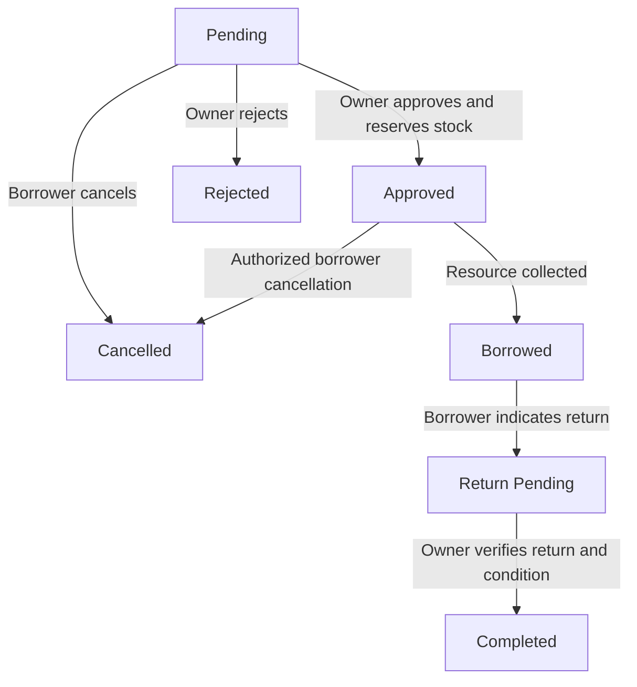

# EventPool — UX Flows, State Transitions & Interaction Logic

This document captures behavioral specifications, conditional navigation, permission rules, validation enforcement, and state persistence across **EventPool** that cannot be inferred from static UI screenshots alone.

---

## 1. Roles & Permissions Matrix

**Authentication is required before accessing the Marketplace or any other application page.** Unauthenticated visitors are redirected to Login (`S1`). Platform administrators have a separate platform-management role; this role does **not** automatically grant authority to act on behalf of a club.

| Action / Route | Unauthenticated Visitor | Authenticated Regular Club Member (Not Authorized) | Authorized Club Representative | Platform Administrator |
| :--- | :--- | :--- | :--- | :--- |
| Browse Marketplace & Filter Listings | Redirect to Login | Allowed (Read-only) | Allowed | Allowed |
| View Resource Details & Availability | Redirect to Login | Allowed (Read-only) | Allowed | Allowed |
| Submit Borrowing Request (`S4`) | Redirect to Login | Blocked (Disabled CTA + Tooltip) | **Allowed** (for represented club) | Only if separately authorized for the requesting club |
| Add / Edit / Archive Club Resources | Redirect to Login | Blocked | **Allowed** (own club only) | Only if explicitly permitted by platform access-control rules |
| Approve / Reject Incoming Requests | Redirect to Login | Blocked | **Allowed** (owning club only) | Only if explicitly permitted by platform access-control rules |
| Cancel Outgoing `Pending` Requests | Redirect to Login | Blocked | **Allowed** (requesting club only) | Only if explicitly permitted by platform access-control rules |
| Cancel Outgoing `Approved` Requests | Redirect to Login | Blocked | **Conditionally allowed** (requesting club, subject to cancellation permission) | Only if explicitly permitted by platform access-control rules |
| Confirm Collection / Indicate Return / Verify Return | Redirect to Login | Blocked | **Allowed** for the appropriate borrower/owner action | Only if explicitly permitted by platform access-control rules |
| Edit Club Profile & Required Contacts | Redirect to Login | Blocked | **Allowed** (own club only) | Only if explicitly permitted by platform access-control rules |
| View Sustainability Impact Dashboard | Redirect to Login | Allowed | Allowed | Allowed |
| Platform Administration | Redirect to Login | Blocked | Blocked unless separately assigned admin role | **Allowed**, within configured administrative permissions |

**Enforcement:** The frontend may hide or disable unauthorized actions, but the backend must validate authentication, role, club ownership, and any conditional cancellation permission on every protected operation.

--- | :--- | :--- | :--- |
| Browse Marketplace & Filter Listings | Allowed (Read-only) | Allowed | Allowed |
| View Resource Details & Availability | Allowed | Allowed | Allowed |
| Submit Borrowing Request (`S4`) | Redirects to Login | Blocked (Disabled CTA + Tooltip) | **Allowed** |
| Add / Edit / Archive Club Resources | Redirects to Login | Blocked | **Allowed** (Own club only) |
| Approve / Reject Incoming Requests | Redirects to Login | Blocked | **Allowed** (Owning club only) |
| Cancel Outgoing Pending Requests | Redirects to Login | Blocked | **Allowed** (Requesting club only) |
| Edit Club Profile & Required Contacts | Redirects to Login | Blocked | **Allowed** (Own club only) |
| View Sustainability Impact Dashboard | Allowed | Allowed | Allowed |

---

## 2. Authentication & Conditional Navigation (`S1 -> S2`)

### Conditional Navigation
* **Already authenticated:** Skips the authentication screen (`S1`) and routes to the Resource Marketplace (`S2`) or an authorized administrative destination.
* **Login success (Linked to a club as an authorized representative):** Grants the permissions assigned to that representative for the linked club and routes to `S2`. Club association alone must not grant representative privileges.
* **Login success (Regular member without representative permissions):** Routes to `S2` in read-only mode, displaying a suitable banner, such as *"Your account isn't authorized to manage a club yet."*
* **Login success (Platform administrator):** Routes to the permitted platform area; administrative functions are subject to explicit administrator access-control rules.
* **Unauthenticated access to any protected page (including `S2`):** Redirects to `S1` and, after successful login, may resume the originally requested destination if authorized.

### Loading State
* Triggering the authentication action transforms the primary call-to-action into a disabled state, displaying a loading spinner until the server responds.

### Validation & Errors
* **Empty email or password:** Triggers inline *"Required"* validation messages directly below the corresponding input fields.
* **Non-UM email format:** Displays inline error: *"Use your UM email (name@um.edu.my)"*.
* **Invalid credentials:** Renders a top-level alert: *"Email or password is incorrect"*. Form inputs retain entered text, while the password field clears automatically.
* **Unauthorised account:** Renders a top-level alert: *"This account isn't authorised for EventPool"*.
* **Network failure:** Renders a top-level alert: *"Couldn't sign in. Check your connection and try again."*

### Success State
* Immediate redirect to `S2` without displaying a secondary confirmation or success transition screen.

---

## 3. Global Navigation & Loading States

### Top Navigation Bar
* **Home:** Serves as the primary landing page and quick-action overview.
* **Marketplace:** Searchable, filterable resource catalog (`S2`).
* **My Club:** Centralized management hub for club profiles, inventory control, incoming/outgoing borrowing requests, and historical logs; shown only when appropriate club permissions exist.
* **Sustainability:** Dedicated analytics view displaying SDG 12 & SDG 13 performance metrics (reused item counts, avoided purchase expenditures, and estimated waste/CO₂ offsets).
* **Global Search Input:** Executing a search query from any authenticated global header view immediately redirects the user to the Marketplace with the specified search key.
* **Administration:** Show an administration entry point only to authenticated platform administrators; available actions remain limited to assigned permissions.

### Loading & Skeleton States
* **Initial Fetch / Route Transition:** Displays a 3-column shimmer skeleton grid matching the target resource card dimensions. Enforces a `300ms` minimum threshold to prevent visual flicker during fast data resolution.
* **Form Submission / Decision Mutations:** Primary submission buttons transition to a disabled state displaying a spinner icon and contextual text (e.g., *"Submitting..."* or *"Saving..."*) to prevent duplicate operations during asynchronous processing.

---

## 4. Resource Marketplace (`S2`) — Search & Filter Transitions

### 4.1 Filter Controls
* **Search Bar:** Real-time text filter, matching queries against `item_name`, `category`, `owner_club`, and `storage_location`.
* **Category Dropdown Options:** `All Categories` (Default), `Furniture`, `Audio/Visual`, `Banners & Stands`, `Decorations`, `Logistics & Storage`.
* **Owner Club Dropdown Options:** `All Clubs` (Default), `PEKOM`, `UMDac`, `GDGoC UM`, `PTUM`, `UMSU`, `EngSoc`, `Kolej Kediaman`.

### 4.2 State Transitions
* **Default State (`S2_Default`):** Renders all active platform listings sorted by availability status (`Available` items prioritized first, followed by `Borrowed` items).
* **Applied-Filter State (`S2C_Filtered_Results`):** Active whenever `search_query` is populated, or `category` / `owner_club` are set to specific values.
  * Renders an **Active Filter Bar** beneath the primary toolbar populated with dismissible filter chips (e.g., `Category: Furniture ✕`, `Owner Club: PTUM ✕`).
  * Displays a right-aligned **`Clear all`** action link.
  * Dynamically updates the active item summary counter (e.g., *"Showing 4 reusable items - 3 available"*).
* **Empty / No-Results State (`S2D_Empty_Filter_State`):** Active when active filter intersections return zero matching items.
  * Retains the top toolbar and active filter bar to preserve context on zero-match criteria.
  * Replaces the primary card grid with a centered empty-state UI container featuring a **`Reset All Filters`** primary action.
  * Clicking **`Reset All Filters`** resets all dropdowns and search inputs to defaults and transitions the view back to `S2_Default`.

---

## 5. Field-Specific Validation & Upload Handling

All form interfaces enforce real-time blur validation combined with submit-time validation blocks across individual input controls.

### 5.1 Borrowing Request Form (`S4`)
* **Trigger:** Initiated when an authorized representative selects **`Request to Borrow`** on an `Available` resource card.
* **Field Rules:**
  * **`Event name *`**: Required. Must select an active or upcoming recognized club event.  
    *Error:* *"Please select an event for this request."*
  * **`Requested quantity *`**: Required integer within range `1` to `available_stock`.  
    *Error:* *"Quantity must be between 1 and [max_available]."*
  * **`Purpose of borrowing *`**: Required string with a minimum length of `10` characters.  
    *Error:* *"Please describe how the resource will be used (min. 10 characters)."*
  * **`Pickup date *`**: Required date field; must be greater than or equal to the current date.  
    *Error:* *"Pickup date cannot be in the past."*
  * **`Expected return date *`**: Required date field; must be strictly after the designated Pickup Date (`return_date > pickup_date`).  
    *Error:* *"Return date must be after the pickup date."*
  * **`Would your club otherwise purchase this item? *`**: Required boolean choice (`Yes` / `No`) for tracking SDG 12 metrics.  
    *Error:* *"Please select Yes or No to help track sustainability impact."*
  * **`Request remarks (optional)`**: Optional field; write a short remark if you have any specific or extra requests.
* **Actions & Outcomes:**
  * **`Cancel` Button:** Discards uncommitted form entries (triggers a confirmation prompt if inputs are dirty) and returns the user to the resource detail view.
  * **`Submit Request` Button:** On validation failure, auto-focuses the first invalid field, highlights input borders in red, and shows inline error messages. On validation success, creates a transaction record marked `Pending`, triggers a success toast (*"Borrowing request submitted to [Owner Club]"*), and redirects to `My Club -> Outgoing Requests`.

### 5.2 Add Resource Form (`My Club -> Inventory`)
* **Field Rules & Media Processing:**
  * **`Item name *`**: Required string input.
  * **`Description *`**: Required string input.
  * **`Category *`**: Required selection from approved list.
  * **`Condition *`**: Required selection (`Like New`, `Good`, `Fair`).
  * **`Location *`**: Required descriptive string (e.g., *"PEKOM storeroom"*).
  * **`Est. unit cost (MYR, optional)`**: Optional numeric input.
  * **`Unit weight (kg, optional)`**: Optional numeric input.
  * **`Remarks`**: Optional string input.
  * **`Resource photo *`**: File upload supporting `.jpg`, `.jpeg`, `.png`, `.webp` formats up to `5 MB`.
    * *Empty State:* Interactive drag-and-drop zone (*"Click to upload or drag image here"*).
    * *Validation Error State:* Invalid formats or files exceeding `5 MB` trigger inline error: *"File must be JPG/PNG/WEBP under 5MB."*
    * *Uploaded Preview State:* Displays image thumbnail, file metadata (name and size), and a **`Remove (x)`** action control.
* **State Persistence on Success:** Successful submissions immediately write the new resource entry to persistent storage with status `Available`. The user is redirected to the Marketplace or `My Club -> Inventory` with a success alert (*"[Item Name] is now live in the Marketplace"*), where the item becomes immediately searchable.

### 5.3 Club Profile & Contact Enforcement (`My Club -> Profile`)
* **Required Fields:** `Club Name *`, `Description`, `Person-in-Charge (PIC) Contact Number *`, and `Contact Email *`.
* **Enforcement & Privacy:** Contact details remain hidden from public view and are revealed exclusively to authorized representatives during active transaction coordination. Invoking **`Save Profile`** blocks submission if any required field is missing or malformed, highlighting error fields inline.

### 5.4 Event Creation Form (`My Club -> Events`)
* **Field Rules:** `Event Name *` (required), `Event Date *` (required), `Purpose *` (required), and `Description` (optional).
* **Persistence:** Newly saved events immediately populate the `Event name *` dropdown menu inside the Borrowing Request Form (`S4`).

---

## 6. Borrowing Lifecycle & Persistent State Transitions

All state changes persist across browser sessions and synchronize across Active Requests, Resource Inventory, and Sustainability History tables. The backend is the authoritative source of status and inventory quantity; the UI must not treat a button click as a confirmed state change until the server succeeds.

* **`Pending`:** Request submitted; no stock is reserved yet.
* **`Approved`:** Owner approves; requested stock is reserved and marketplace availability decreases.
* **`Borrowed`:** Approved resources have been physically collected; the reservation remains in effect.
* **`Return Pending`:** Borrower reports the resources returned; **inventory remains reserved** until successful owner verification.
* **`Completed`:** Owner verifies the return and condition; stock is restored and the transaction counts toward completed reuse metrics.
* **`Rejected` / `Cancelled`:** Terminal outcomes. A rejected or pending-cancelled request does not reserve stock; an approved-cancelled request releases its existing reservation only after authorized cancellation succeeds.

### 6.1 Outgoing Request Cancellation (Borrower Action)
1. In `My Club -> Outgoing Requests`, the requesting club's authorized representative may select **`Cancel Request`** on a `Pending` request. Cancellation of an `Approved` request is also possible **only when the backend's cancellation permission rules allow it**. Cancellation is not available for `Borrowed`, `Return Pending`, `Completed`, `Rejected`, or already `Cancelled` requests.
2. A confirmation modal shows the item and current request status. For an `Approved` request, it also states that an existing stock reservation will be released after successful cancellation.
3. After confirmation, submit the cancellation to the backend. The backend rechecks the current state, requesting-club ownership, and permission to cancel; on success it writes `Cancelled` and a cancellation timestamp.
4. If the request was `Approved`, the backend restores the **reserved** quantity atomically with the cancellation. If it was `Pending`, there is no reservation to restore.
5. Show the final `Cancelled` status in history and refresh outgoing requests and marketplace inventory. On denial, conflict, or network failure, retain the authoritative status, explain the error and allow an appropriate retry. Do not optimistically release inventory.

### 6.2 Incoming Request Decision (Owner Action)
1. Within `My Club -> Incoming Requests`, the authorized owning-club representative reviews an incoming `Pending` request.
2. **Approval Path:** Clicking **`Approve`** triggers an authoritative backend check of `available_stock >= requested_quantity`, ownership and current status.
   * On success, status becomes `Approved`; the requested quantity is reserved and available stock decreases **atomically**, preventing simultaneous approvals from over-reserving inventory.
   * If available stock reaches `0`, the marketplace listing is displayed as unavailable / fully borrowed while the transaction status remains `Approved` until physical collection.
   * Direct contact information for the participating representatives is unlocked for pickup coordination according to the established privacy rules.
   * If stock is insufficient or status has changed, show the server error and refresh quantities instead of confirming approval.
3. **Rejection Path:** Clicking **`Reject`** opens an optional feedback field (e.g., *"Clashes with internal faculty event"*).
   * On successful backend confirmation, status becomes `Rejected`; no stock is reserved, and the record appears in history.

### 6.3 Collection, Return Reporting & Owner Verification
1. **Collection (`Approved -> Borrowed`):** When physical handover is confirmed through the authorized collection action, record `Borrowed`. Keep the existing reservation; do not deduct inventory again.
2. **Return reporting (`Borrowed -> Return Pending`):** The borrower indicates return through the corresponding action. Show `Return Pending` to both clubs, but **do not restore stock** merely because the borrower reports a return.
3. **Owner verification (`Return Pending -> Completed`):** The authorized resource owner verifies that the items were returned and checks their condition. Only a successful backend verification transitions the request to `Completed` and restores the corresponding reserved quantity atomically. Refresh the Marketplace, inventory records, history and sustainability metrics after success.
4. **Unsuccessful or incomplete verification:** Do not mark the transaction `Completed` or restore stock. Keep it awaiting resolution under the backend's approved handling rules; do not invent an additional lifecycle status without agreement on the backend contract.
5. **History:** `Completed`, `Rejected`, and `Cancelled` transactions remain visible with their final statuses. Active transactions (`Pending`, `Approved`, `Borrowed`, `Return Pending`) remain distinguishable in active request views.

---

## 7. Sustainability Dashboard (SDG 12 & SDG 13 Impact Tracking)

### 7.1 Metric Calculation & Aggregation Rules
* **Trigger Condition:** Metrics update strictly when a borrowing transaction transitions to `Completed`. Requests in `Pending`, `Approved`, `Borrowed`, `Return Pending`, `Rejected`, or `Cancelled` states are excluded from sustainability totals.
* **Items Reused:** Total count of completed borrowing transactions (`status == "Completed"`) and total units circulated across UM student clubs.
* **Estimated Cost Savings / Avoided Purchases (MYR):** Calculated as `est_unit_cost * requested_quantity` only for `Completed` transactions where the borrower selected *"Yes"* to *"Would your club otherwise purchase this item?"* on the Borrowing Request Form (`S4`).
* **Estimated Waste & CO₂ Avoided (kg):** Calculated as `unit_weight * requested_quantity` (or category-level baseline averages when optional weight is omitted) for avoided-purchase transactions to quantify SDG 12 waste reduction and SDG 13 carbon footprint savings.
* **Missing Optional Metadata Handling:** Because `Est. unit cost (MYR)` and `Unit weight (kg)` are optional fields on the Add Resource Form, items lacking these values still increment **Items Reused** without breaking MYR/kg totals (handled via category fallback estimates or excluded from monetary/weight sums with an explanatory tooltip).

### 7.2 Interactive Controls & Scope Filtering
* **Scope Toggle:** Allows authenticated members and club representatives to switch between **Campus-Wide Impact (All UM Clubs)** and **My Club Impact** (visible when authenticated and linked to a club).
* **Time Period Filter:** Filtering by academic semester or date range dynamically recalculates KPI cards, category breakdown charts, and top contributing clubs.

### 7.3 Loading, Empty & Error States
* **Loading State:** Displays skeleton shimmer placeholders across KPI summary cards and chart containers while aggregating verified completed-transaction records.
* **Empty State (Zero Verified Completions):** When a newly onboarded club or selected date range has zero `Completed` transactions, KPI cards display `0` alongside an empty-state callout: *"No completed reuses recorded yet. Borrow or lend items in the Marketplace to start tracking your club's SDG 12 & 13 impact"* with a primary CTA button navigating to `Marketplace`.
* **Calculation / Fetch Error State:** If aggregation fails, displays an inline retry banner (*"Unable to load sustainability metrics. Retry"*) without crashing the page.