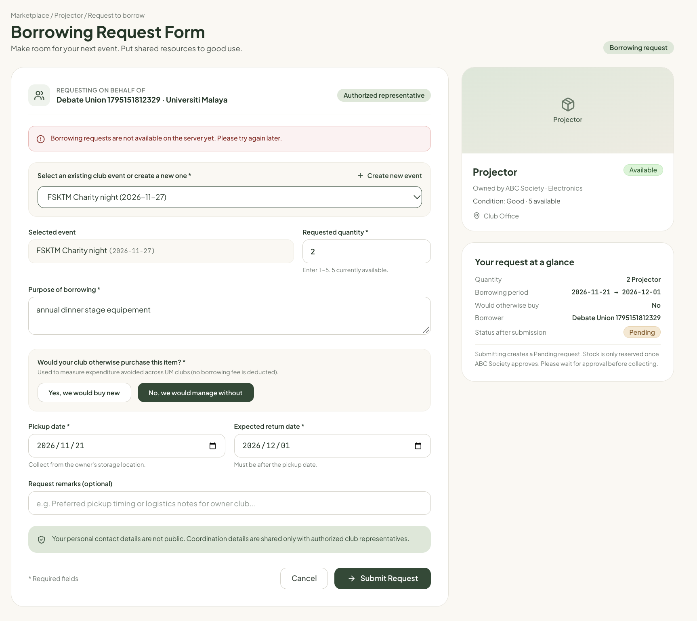
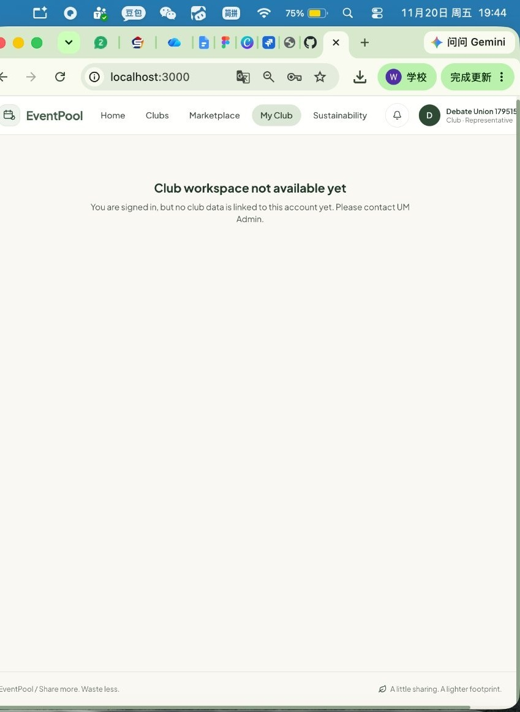
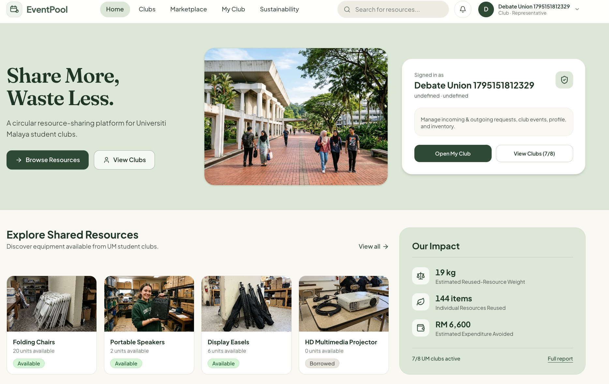
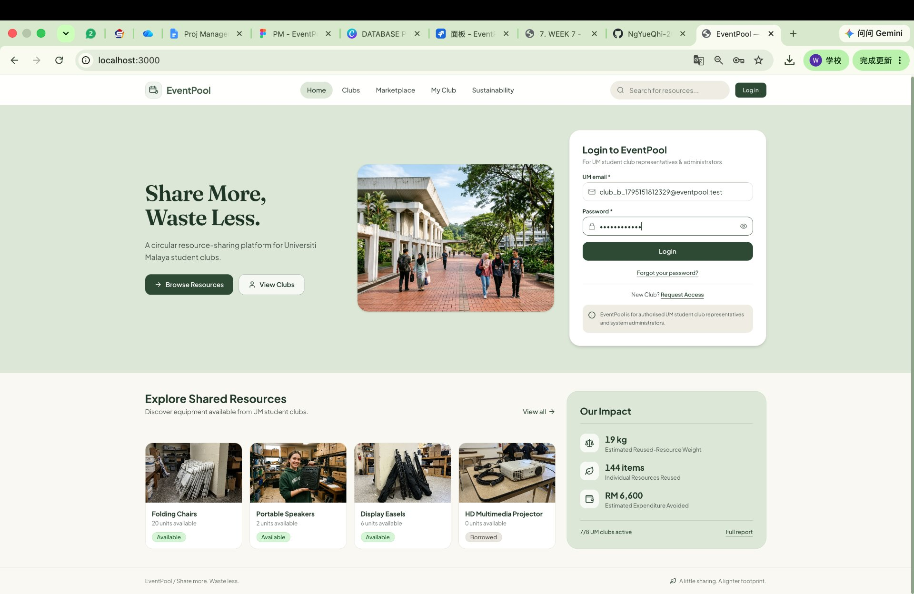
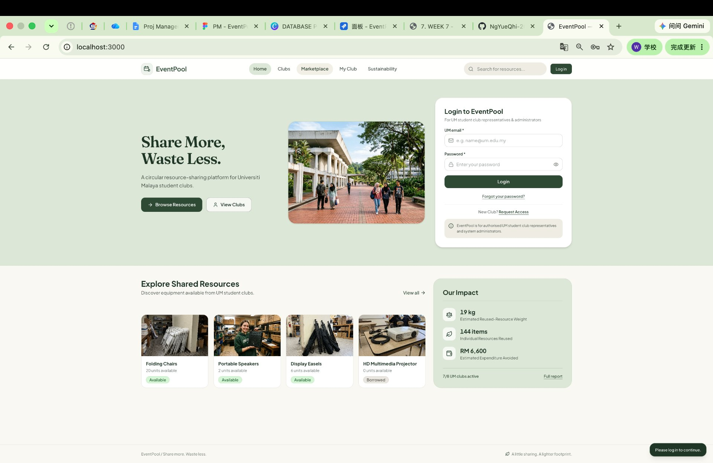

# Sprint 1 Test Execution Record

**Project:** EventPool (WIX2002)
**Executed by:** WEI XIN — QA Engineer (M9)
**Date:** 20 November 2026, 19:30–19:50 (GMT+8)
**Build under test:** `main` @ `44e9c3e`
**Related:** Jira `EPM-62`, `EPM-63` · Gantt task `4.2` · Defects in `BUGS.md`

---

## 1. Result summary

| Metric | Count |
| --- | --- |
| Cases executed | 17 (API) + 15 steps (browser, all executed) |
| Passed | 12 API, 10 browser |
| Failed | 4 API, 5 browser |
| Observation only (not a defect) | 1 |
| Blocked / not executed | see section 5 and the coverage limit in section 8 |

**Verdict:** the authentication, authorisation and resource-reading layers work. The entire borrowing module does not exist on the server. Sprint 1 cannot be accepted — see `sprint-acceptance-checklist.md`.

---

## 2. Environment

This is the first round in which anything could actually be executed. The earlier review round was static only, because the backend cannot start without a Firebase service-account key and no deployed instance exists.

| Component | Value |
| --- | --- |
| Frontend | Vite dev server, `http://localhost:3000` |
| Backend | Express, `http://localhost:5001` (see the start-up note below) |
| Database | Firebase project `eventpool-78758` (Firestore + Authentication) |
| Test account | `club_b_1795151812329@eventpool.test` — account type `club`, active |
| Second account | `club_a_1795151812329@eventpool.test` — deliberately disabled, used for the disabled-login case |
| Interface used | API level. The browser click-through round is separate — see `manual-ui-test-guide.md` |
| Credentials | held by M7 and QA; not written here and not to be committed (see BUG-005) |

**Start-up note.** The documented commands do **not** produce a working stack, because the frontend proxies `/api` to port 5001 while the backend defaults to 5000 (BUG-002). This run therefore used an explicit port override:

```bash
cd backend && PORT=5001 node src/server.js
# second terminal, repository root
npm run dev
```

---

## 3. Executed cases

| ID | Case | Expected | Actual | Verdict |
| --- | --- | --- | --- | --- |
| TC-A1 | Sign in with a valid club account | ID token issued | Token issued | **PASS** |
| TC-A2 | Sign in with a disabled account | Rejected, `USER_DISABLED` | `USER_DISABLED` | **PASS** |
| TC-A3 | Sign in with a wrong password | Rejected, `INVALID_LOGIN_CREDENTIALS` | `INVALID_LOGIN_CREDENTIALS` | **PASS** |
| TC-S1 | `GET /api/resources` with no token | `401 UNAUTHORIZED` | `401 UNAUTHORIZED` | **PASS** |
| TC-S2 | `GET /api/resources` with a forged token | `401 UNAUTHORIZED` | `401 UNAUTHORIZED` | **PASS** |
| TC-S3 | `GET /api/admin/dashboard` with a club token | `403 FORBIDDEN` | `403 FORBIDDEN` | **PASS** |
| TC-R1 | `GET /api/resources` with a valid token | `200` + items + pagination | `200`, 1 item, `pagination {page:1, limit:10, total:1, totalPages:1}` | **PASS** |
| TC-R2 | `GET /api/resources/RES001` | `200` + resource body | `200`, `itemName: Projector` | **PASS** |
| TC-R3 | `GET /api/resources/NOT-EXIST-999` | `404 RESOURCE_NOT_FOUND` | `404 RESOURCE_NOT_FOUND` | **PASS** |
| TC-R4 | `GET /api/resources/search?q=projector` | at least one hit | 1 hit | **PASS** |
| TC-R5 | `GET /api/resources/search?q=banner` | a hit if a Banner exists | 0 hits — no Banner in the data | **Observation** |
| TC-R6 | Stock invariant `total = available + reserved + borrowed` | holds for every record | holds (Projector: 5 = 5 + 0 + 0) | **PASS** |
| TC-B1 | `GET /api/borrowing-requests` | `200` | `404 Route not found` | **FAIL** — BUG-001 |
| TC-B2 | `POST /api/borrowing-requests` (FR3.1 Must) | request created as `Pending` | `404 Route not found` | **FAIL** — BUG-001 |
| TC-B3 | `PATCH /api/borrowing-requests/REQ001/approve` (FR3.3 Must) | `200`, available → reserved | `404 Route not found` | **FAIL** — BUG-001 |
| TC-B4 | `PATCH /api/borrowing-requests/REQ001/reject` | `200`, stock unchanged | `404 Route not found` | **FAIL** — BUG-001 |
| TC-H1 | `GET /api/health` | `200 healthy` | `200 {"status":"healthy"}` | **PASS** |

---

## 4. What the failures mean

All four failures are the same defect: the borrowing-request route group was never registered on the server. This is one bug with four symptoms, logged once as **BUG-001 (Critical)**.

Why Critical rather than Major:

- FR3.1 (submit), FR3.2 (cancel), FR3.3 (approve or reject) and FR3.4 (mark as borrowed) are all `Must`. None can be reached.
- The seed data already contains a `BorrowingRequests` record `REQ001`, so the collection and schema exist. The front end is fully built. Only the server layer is missing — which is precisely how a demo can look complete while the product is not.
- Every other route group answered correctly in the same run, so the failure cannot be blamed on the environment, the token or the network.

---

## 5. Not executed, and why

| Case area | Status | Reason |
| --- | --- | --- |
| M2 create / edit / archive resource, toggle availability | Not executed | These write to the shared database. Without a disposable test project (risk DR-04) a test would leave permanent records in the only database the team has. |
| M3 full state machine, all 7 transitions | Not executed | Impossible until BUG-001 is fixed. |
| M5 return and condition tracking | Not executed | Depends on M3. |
| M6 sustainability dashboard, admin dashboard | Not executed | Requires an admin token; admin credentials were not available. |
| Concurrency: two clubs borrowing the last unit | Not executed | Depends on M3. This is the case that decides whether the transaction logic is correct; scheduled for weeks 9–10. |
| Backend automated suite `npm run test:verify` (41 cases) | Not executed | It creates clubs and users as a side effect, which would pollute the shared project. |
| Frontend UI: wording, layout, error messages, badge colours | Not executed | Needs a human to judge. Click-through guide: `manual-ui-test-guide.md`. |

---

## 6. Data observations

Recorded because they affect the repeatability of this round, not because they are defects.

| Observation | Detail | Action |
| --- | --- | --- |
| Many test accounts are disabled | 6 of 12 Firebase Auth accounts are `disabled=true`, including four `club_a_*` accounts | Whoever re-runs these tests must pick an enabled account or re-enable one first. Write this into the test-data spec. |
| The club collection carries duplicates | `Clubs` holds 11 documents for what should be a handful of test clubs, plus duplicate field spellings `authUId` / `authUid` | Clean-up task for M7. Not a defect — `auth.js` already falls back between the two spellings. |
| Only one resource is visible | `GET /api/resources` returns 1 record for the test account; the other `Resources` documents belong to inactive clubs or are archived | Five seed resources were promised in the test-data spec (DR-04). Until then, list and filter cases cannot be exercised meaningfully. |
| No Banner, no second category | The visible record is `Projector` / `Electronics` | Keyword search and category filter are only weakly covered. |

---

## 7. How to re-run this round

1. Obtain the service-account key from M7 and place it at `backend/serviceAccountKey.json`. It is git-ignored — never commit it.
2. Start the backend with an explicit port: `cd backend && PORT=5001 node src/server.js`
3. Start the frontend: `npm run dev` at the repository root.
4. Confirm connectivity: `curl --noproxy '*' http://127.0.0.1:5001/api/health` → `200`.
5. Sign in with an active club account and record the ID token.
6. Repeat the 17 cases in section 3, updating the verdict column.

**Re-run rule.** When BUG-001 is fixed, TC-B1 to TC-B4 must be re-executed **plus** the regression set TC-A1 to TC-R6, because a new route group touches the auth middleware and can break authorisation without breaking the new endpoints.

---

## 8. Browser click-through round — 20 November 2026, 19:40–20:00

Executed by WEI XIN as a non-technical tester working from `manual-ui-test-guide.md`, in a normal Chrome session against the same stack. No devtools knowledge was required except for the optional network capture in UI-07. This round exists because API testing cannot judge wording, layout, empty states or whether a screen is usable — and it found three defects the API round could not see.

| ID | Case | Observation | Verdict |
| --- | --- | --- | --- |
| UI-01 | Signed-out landing page | Loads, shows hero, four resource cards, `Our Impact` (`19 kg`, `144 items`, `RM 6,600`, `7/8 clubs active`) | **FAIL** — BUG-008: these four cards and the impact figures come from demo fixtures; the live catalogue holds one resource |
| UI-02 | Signed-out → click Marketplace | Catalogue is replaced by the sign-in card, toast "Please log in to continue" | **FAIL** — BUG-003 confirmed in the browser |
| UI-03a | Sign in | Accepts the account, header shows `Debate Union 1795151812329 · Representative` | **PASS** |
| UI-03b | My Club | "Club workspace not available yet — You are signed in, but no club data is linked to this account." | **FAIL** — BUG-006 |
| UI-04 | Marketplace list | 1 resource: Projector, ABC Society · 5 units, badge `Available`, "Showing 1–1 of 1" | **PASS** — matches the API |
| UI-05a | Search `projector` | 1 hit, chip "Search: projector", heading changes to Filtered Resources | **PASS** |
| UI-05b | Search `banner` / `zzz` | 0 hits, readable empty state "No matching resources found" + Clear All Filters | **PASS** — empty state is well handled |
| UI-06 | Filters (category / owning club / availability / location) | All four dropdowns open and list plausible options | **PASS**, with one data observation — six owning clubs, five of them duplicates (see BUGS.md, cleared observations) |
| UI-07a | Resource detail | Name, `Available quantity 5 of 5`, Condition, Location, Category, Description, Remarks, owner club block, "Request to borrow" button | **PASS** |
| UI-07b | Borrow form, submit with required fields empty | Nothing appeared to happen; no field focused, no scroll. Message "Please fix the highlighted fields before submitting." was rendered one screen above the button | **FAIL** — BUG-007 |
| UI-07c | Create a club event inline | `FSKTM Charity night`, `2026-11-27` created; `GET /api/events` then returned it | **PASS** — event creation works |
| UI-07d | Borrow form completed correctly, then submit | Red banner at the top of the form: "Borrowing requests are not available on the server yet. Please try again later." The summary panel still shows `Status after submission: Pending`, but nothing is stored | **FAIL** — BUG-001, screenshot captured |
| UI-08 | Refresh (`Cmd + R`) after the failed submission | Session retained, page returns to the home screen. Two observations: the fake "Pending" request is gone (confirming nothing was written), and the signed-in card reads `undefined · undefined` instead of the club | **PASS** on session, **FAIL** on the card — BUG-006 second symptom |
| UI-09 | Sign in with the disabled account `club_a_1795151812329@eventpool.test` | Refused with "This account has been disabled by UM Admin. Contact Student Affairs to reactivate it." — clearly distinguishes a disabled account from a wrong password | **PASS** |
| UI-10 | Sign out, then click Marketplace | Sign-out works: the header returns to the `Login` button, the landing page shows the sign-in card, and the session does not survive a reload. Clicking Marketplace afterwards is blocked again with the toast "Please log in to continue" | **PASS** on sign-out — and a second, independent confirmation of BUG-003 |

**What this round proves.** The read path (sign-in, list, detail, search, filters, empty states) is presentable and behaves correctly. The write path is broken in two different ways at once: the borrowing endpoint does not exist, and the page's own error handling hides that fact from the person clicking the button.

**Coverage limit.** All fifteen browser steps in this round were executed; nothing in the click-through is left open. What remains untested is by choice, not by omission — M2 write operations and the full M3/M5 state machine cannot be exercised until BUG-001 is fixed and a disposable Firebase project exists (DR-04).

### 8.1 Manual acceptance evidence

Sixteen screenshots were captured during the round and are filed in `../evidence/screenshots/sprint-1/`, with an index in `INDEX.md`. The four that carry the verdict:

**BUG-001 — a correctly completed form is refused by the server.**



**BUG-006 — the club workspace cannot find the signed-in club**, and the same missing lookup renders as `undefined · undefined` on the home screen after a refresh.




**BUG-008 — the landing page and the catalogue describe different inventories.**



**Sign-out behaves correctly**, and re-entering Marketplace afterwards is refused again — the same gate as BUG-003, reproduced on a clean session:



These images are the manual-acceptance evidence for the report: they were produced by a human using the product, not by reading source code, and every one of them can be reproduced in under a minute by following `manual-ui-test-guide.md`.
