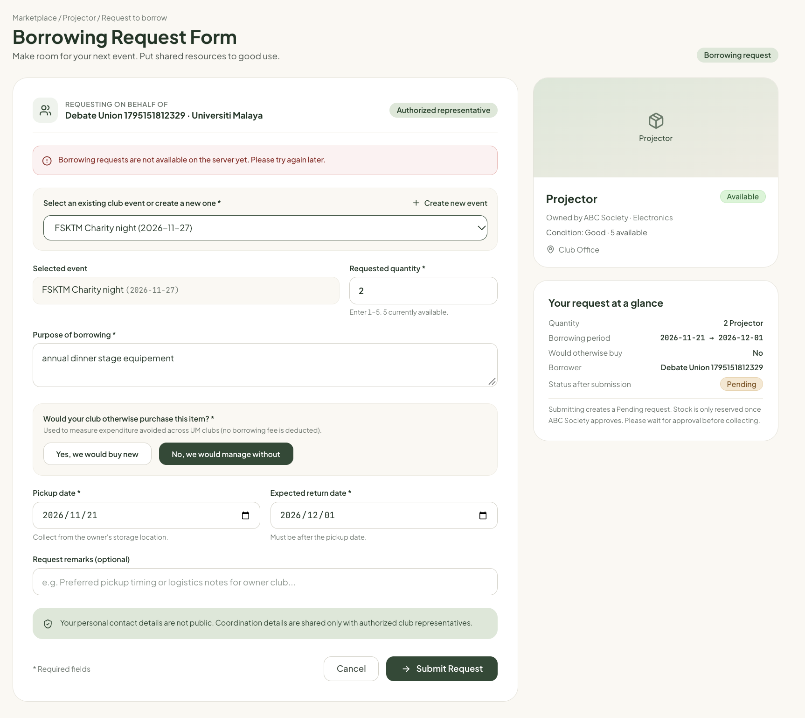
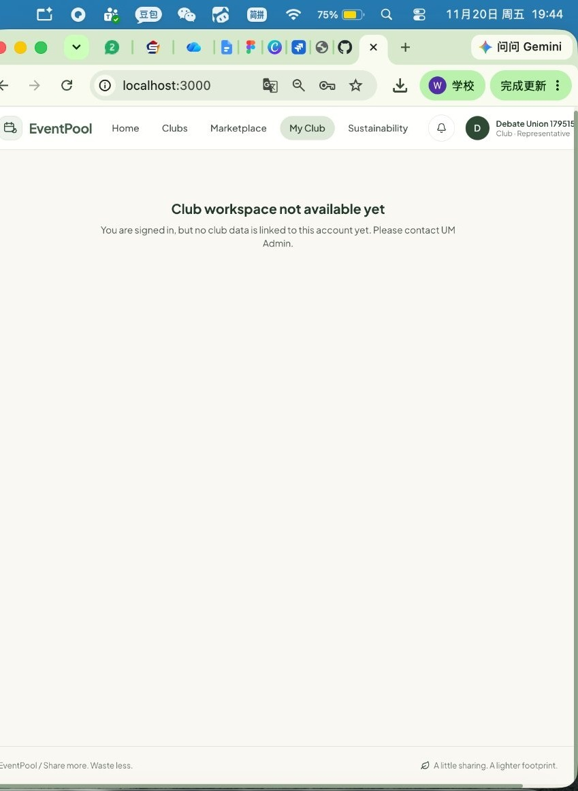
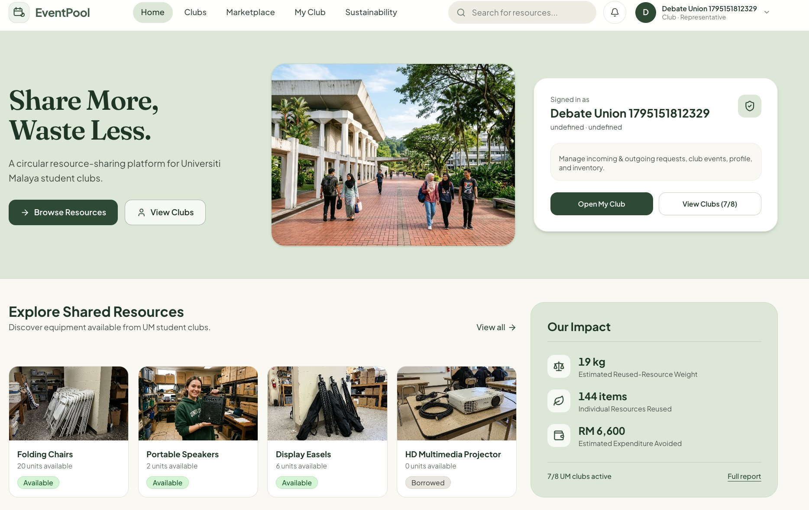
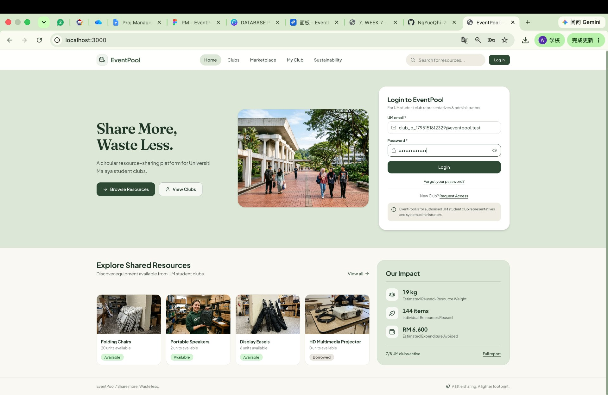
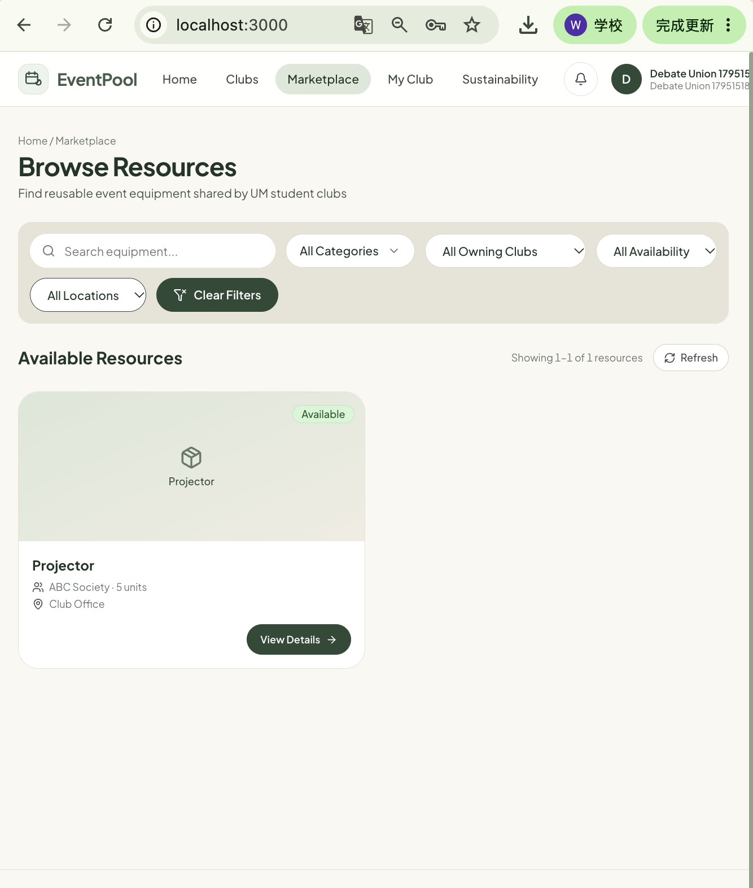

# Sprint 1 evidence — browser round

Captured by WEI XIN (QA, M9) on 20 November 2026, 19:40–20:20 (GMT+8).
Build: `main` @ `44e9c3e`. Stack: Vite `:3000` → Express `:5001` → Firebase `eventpool-78758`.
Signed in as `club_b_1795151812329@eventpool.test` (Debate Union 1795151812329) unless stated otherwise.

The `m6-*.png` files in this folder are the feature owner's design captures, kept for comparison. They were taken while signed in as the **demo fixture** account (Alice Tan · PEKOM), which is why the club workspace renders there and not in `ui-03` — see BUG-006.

| File | Case | What it shows | Defect |
| --- | --- | --- | --- |
| `ui-01-landing-page.jpg` | UI-01 | Signed-out landing page: hero, four resource cards, `Our Impact` = 19 kg / 144 items / RM 6,600 / 7 of 8 clubs | BUG-008 |
| `ui-02-marketplace-login-wall.jpg` | UI-02 | Clicking Marketplace while signed out replaces the catalogue with the sign-in card; toast "Please log in to continue" bottom-right | BUG-003 |
| `ui-03-myclub-empty.jpg` | UI-03 | My Club shows "Club workspace not available yet" while the header shows the club name | BUG-006 |
| `ui-04-marketplace-list.png` | UI-04 | Marketplace after sign-in: 1 resource (Projector, ABC Society · 5 units, Available), "Showing 1–1 of 1" | — |
| `ui-05a-search-projector.png` | UI-05 | Search `projector` → 1 hit, applied-filter chip, heading switches to "Filtered Resources" | — |
| `ui-05b-search-banner-empty.png` | UI-05 | Search `banner` → 0 results, readable empty state with "Clear All Filters" | — |
| `ui-05c-search-zzz-empty.png` | UI-05 | Search `zzz` → 0 results, same empty state | — |
| `ui-06a-filter-category.png` | UI-06 | Category dropdown: All / Furniture / Audio Equipment / Lighting / Electronics / Decorations | — |
| `ui-06b-filter-owning-clubs.png` | UI-06 | Owning-club dropdown: six clubs, five named `Debate Union <timestamp>` | data pollution (DR-04) |
| `ui-06c-filter-availability.png` | UI-06 | Availability dropdown: All / Available / Reserved / Borrowed / Unavailable | — |
| `ui-06d-filter-location.png` | UI-06 | Location dropdown: All Locations / Club Office | — |
| `ui-06-resource-detail.jpg` | UI-06 | Resource detail: Available quantity 5 of 5, Condition Good, Location Club Office, Category Electronics, Description, Remarks, owner club block, "Request to borrow" | — |
| `ui-07a-borrow-form-empty.png` | UI-07 | Borrowing request form with required fields empty — clicking Submit produced no visible change | BUG-007 |
| `ui-07c-borrow-form-filled.png` | UI-07 | Form completed correctly: event `FSKTM Charity night (2026-11-27)`, quantity 1, purpose filled, dates 21 Nov → 23 Nov | — |
| `ui-07b-borrow-submit-error.png` | UI-07 | **The key screenshot.** Submit pressed → red banner at the top of the form: "Borrowing requests are not available on the server yet. Please try again later." Request still shows `Pending` in the summary panel, but nothing is stored | **BUG-001** |
| `ui-08-after-refresh-undefined.jpg` | UI-08 | After `Cmd + R`: session is retained and the home page re-renders, but the signed-in card reads `undefined · undefined` | BUG-006 (second symptom) |
| `ui-09-disabled-account.png` | UI-09 | Disabled account login → "This account has been disabled by UM Admin. Contact Student Affairs to reactivate it." | — (this is correct behaviour) |
| `ui-10-after-signout-marketplace.jpg` | UI-10 | Signed out cleanly (header back to `Login`), then Marketplace clicked again → still gated, toast "Please log in to continue" | second confirmation of BUG-003 |

---

## The three screenshots that carry the round

**BUG-001 — the borrowing endpoint does not exist.** The form is filled correctly, the button is pressed, and the only thing that happens is a server-side refusal:

**BUG-006 — My Club cannot find the signed-in club.** The header shows the club name; the page says no club data is linked. After a refresh the same missing lookup renders as `undefined · undefined`:

**BUG-008 — two catalogues.** The landing page advertises four resources and an impact dashboard; the marketplace holds one real resource:

---

**Still to capture** (optional):

- `ui-07d-network-404.png` — DevTools Network tab showing `POST /api/borrowing-requests` → 404. The red banner in `ui-07b` is already sufficient evidence, but the 404 makes it undeniable. Worth 30 seconds if a reviewer asks "how do you know it was the server?".
